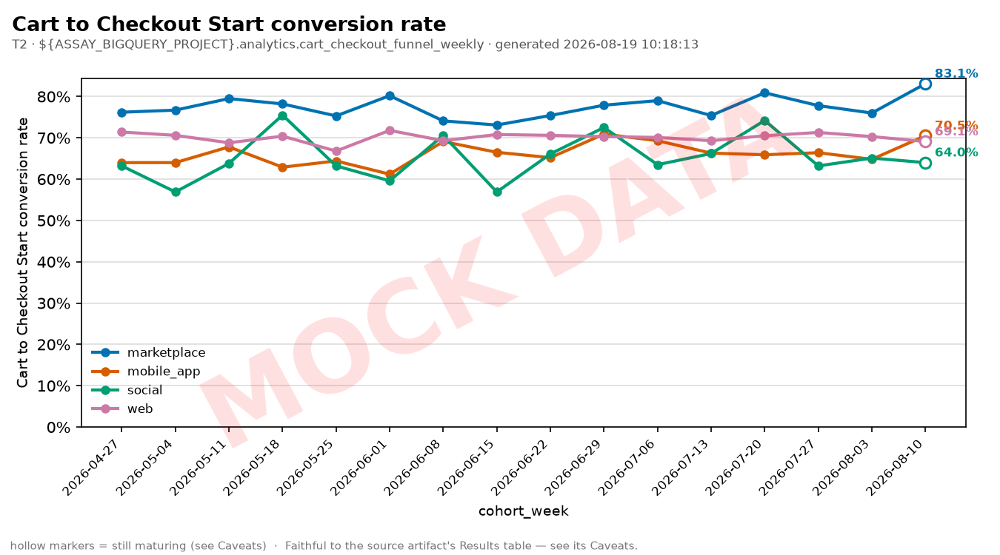

# Cart to Checkout Start conversion rate — 2026-04-27 to 2026-08-10

**Accuracy tier:** T2 (operational — decision-grade for product and process
discussions, not regulator-facing)
**Source view:** `${ASSAY_BIGQUERY_PROJECT}.analytics.cart_checkout_funnel_weekly` (fixture_sql)
**Engine:** sqlite — capabilities: pushdown_aggregation
**Generated:** 2026-08-19T10:18:13

> ⚠️ **FIXTURE DATA** — these numbers come from committed synthetic
> fixtures, not from a warehouse. They describe a seeded random process.
> (ASSAY_ENGINE=sqlite — the metric's SQL is running against the committed fixture CSVs loaded into in-memory sqlite)

**Volume:** 13,199 / 19,007 over the period (64 rows).

## Results

| cohort_week | channel | Cart → Checkout | numerator | denominator |
| --- | --- | --- | --- | --- |
| 2026-04-27 | marketplace | 76.2% | 80 | 105 |
| 2026-04-27 | mobile_app | 64.0% | 222 | 347 |
| 2026-04-27 | social | 63.2% | 43 | 68 |
| 2026-04-27 | web | 71.4% | 475 | 665 |
| 2026-05-04 | marketplace | 76.7% | 102 | 133 |
| 2026-05-04 | mobile_app | 64.0% | 231 | 361 |
| 2026-05-04 | social | 56.9% | 29 | 51 |
| 2026-05-04 | web | 70.6% | 464 | 657 |
| 2026-05-11 | marketplace | 79.5% | 105 | 132 |
| 2026-05-11 | mobile_app | 67.8% | 246 | 363 |
| 2026-05-11 | social | 63.8% | 37 | 58 |
| 2026-05-11 | web | 68.8% | 458 | 666 |
| 2026-05-18 | marketplace | 78.2% | 86 | 110 |
| 2026-05-18 | mobile_app | 62.9% | 219 | 348 |
| 2026-05-18 | social | 75.5% | 40 | 53 |
| 2026-05-18 | web | 70.4% | 404 | 574 |
| 2026-05-25 | marketplace | 75.3% | 70 | 93 |
| 2026-05-25 | mobile_app | 64.4% | 221 | 343 |
| 2026-05-25 | social | 63.2% | 36 | 57 |
| 2026-05-25 | web | 66.8% | 406 | 608 |
| 2026-06-01 | marketplace | 80.2% | 89 | 111 |
| 2026-06-01 | mobile_app | 61.2% | 216 | 353 |
| 2026-06-01 | social | 59.6% | 28 | 47 |
| 2026-06-01 | web | 71.8% | 436 | 607 |
| 2026-06-08 | marketplace | 74.1% | 80 | 108 |
| 2026-06-08 | mobile_app | 69.1% | 221 | 320 |
| 2026-06-08 | social | 70.6% | 48 | 68 |
| 2026-06-08 | web | 69.3% | 442 | 638 |
| 2026-06-15 | marketplace | 73.1% | 79 | 108 |
| 2026-06-15 | mobile_app | 66.5% | 242 | 364 |
| 2026-06-15 | social | 56.9% | 37 | 65 |
| 2026-06-15 | web | 70.8% | 435 | 614 |
| 2026-06-22 | marketplace | 75.4% | 89 | 118 |
| 2026-06-22 | mobile_app | 65.2% | 217 | 333 |
| 2026-06-22 | social | 66.1% | 39 | 59 |
| 2026-06-22 | web | 70.6% | 464 | 657 |
| 2026-06-29 | marketplace | 77.9% | 95 | 122 |
| 2026-06-29 | mobile_app | 70.9% | 241 | 340 |
| 2026-06-29 | social | 72.5% | 37 | 51 |
| 2026-06-29 | web | 70.3% | 472 | 671 |
| 2026-07-06 | marketplace | 79.0% | 83 | 105 |
| 2026-07-06 | mobile_app | 69.3% | 253 | 365 |
| 2026-07-06 | social | 63.5% | 40 | 63 |
| 2026-07-06 | web | 70.1% | 468 | 668 |
| 2026-07-13 | marketplace | 75.4% | 92 | 122 |
| 2026-07-13 | mobile_app | 66.3% | 238 | 359 |
| 2026-07-13 | social | 66.2% | 43 | 65 |
| 2026-07-13 | web | 69.3% | 466 | 672 |
| 2026-07-20 | marketplace | 80.9% | 106 | 131 |
| 2026-07-20 | mobile_app | 65.9% | 220 | 334 |
| 2026-07-20 | social | 74.2% | 49 | 66 |
| 2026-07-20 | web | 70.5% | 496 | 704 |
| 2026-07-27 | marketplace | 77.8% | 98 | 126 |
| 2026-07-27 | mobile_app | 66.4% | 235 | 354 |
| 2026-07-27 | social | 63.2% | 43 | 68 |
| 2026-07-27 | web | 71.3% | 502 | 704 |
| 2026-08-03 | marketplace | 76.0% | 98 | 129 |
| 2026-08-03 | mobile_app | 64.8% | 250 | 386 |
| 2026-08-03 | social | 65.1% | 41 | 63 |
| 2026-08-03 | web | 70.3% | 486 | 691 |
| 2026-08-10 | marketplace | 83.1% | 113 | 136 |
| 2026-08-10 | mobile_app | 70.5% | 291 | 413 |
| 2026-08-10 | social | 64.0% | 32 | 50 |
| 2026-08-10 | web | 69.1% | 475 | 687 |

## Visualization



**Chart type:** multi_series_line — 4 series over 16 time points (≤6) → multi-series trend line.
**Spec:** `chart-spec.json` (the exact points plotted) — see also the interactive
version, `interactive-chart.html`, and the PDF export, `query-metric-report.pdf`,
both rendered from this same run.
**Renderer:** matplotlib 3.11.1

> Drawn only from the Results table above. No re-query, no smoothing, no
> extrapolation. Rate axes anchor at 0.
> Hollow markers mark cohort weeks that are still maturing — see Caveats.
> The MOCK DATA watermark is not decorative: these numbers come from
> committed synthetic fixtures.


## Narrative

`cart_to_checkout_start_conversion` over 2026-04-27 to 2026-08-10, split by channel,
computed as SUM(numerator) / SUM(denominator) per cohort week. The headline volume is
13,199 of 19,007.

This artifact was composed by `scripts/demo.py`, which scripts a deliberately plain
version of the narrative step so the compose chain is mechanically runnable. In normal
use the agent writes this section against the actual question asked. The numbers are
fixture-backed and describe a seeded random process, not a business.

## Caveats

- **Channel mix moves this number without anything changing.** The channels
  converting between 55% and 76% means a shift in traffic mix alone will move the
  blended rate. Slice by `channel` before concluding the checkout got worse. This
  is the metric most often misread in the module.
- **A cart is not an intent to buy.** Add-to-cart is used as a bookmark, a price
  check, and a shipping-cost probe. A "low" rate here is partly a statement about
  how the cart is used, not only about checkout friction.
- **Cohort anchor is cart creation.** A cart created on a Sunday and returned to on
  Wednesday counts in Sunday's cohort week.
- **Settles almost immediately** (stage `checkout_started`, lag 0d). Mature as soon
  as the cohort week completes, so this is the one funnel metric that can be read
  fresh — do not apply the deep-stage lag to it out of caution, or you will withhold
  six weeks of readable data for no reason.
- **Includes the retired checkout.** The `v1-legacy` cohort sits in the first weeks
  of the window and converted measurably worse. Filter `checkout_version=v2`, or
  restrict the time range past the cutover, for a like-for-like trend.
- **Synthetic in this template.** See `LINEAGE.md`, `fixture_data_is_synthetic`.


### Run warnings
- FIXTURE DATA: source mode is fixture_sql — ASSAY_ENGINE=sqlite — the metric's SQL is running against the committed fixture CSVs loaded into in-memory sqlite. These numbers come from committed synthetic fixtures and describe a seeded random process, not any real business. Every downstream chart, dashboard, and PDF is watermarked accordingly.
- MATURITY: 'cart_to_checkout_start_conversion' uses a per-metric maturity lag of 0d (stage_maturity[checkout_started]); cohort weeks after 2026-08-10 are withheld as not-yet-settled for stage 'checkout_started'. The lag itself is hand-authored and illustrative, NOT measured — a real deployment regenerates the stage_maturity table by measuring settle time on the spine.
- DISCONTINUITY: the 2026-04-27..2026-08-10 window crosses 2026-06-01 (delivery scan feed switched providers). Ship-to-deliver timestamps come from a different carrier feed after this date, with finer scan granularity. Delivered COUNTS are unaffected; ship-to-deliver percentiles shift by roughly half a day for feed reasons alone. Read a timing trend that crosses this date as two segments.
- CAVEAT (weekly_aggregate_is_a_narrower_interface): This view is pre-summed at cohort_week x channel x payment_method x market x category x checkout_version. It cannot express a percentile, a terminal-branch decomposition, or "did ANY of this customer's carts reach X" — those need the session spine. That narrowness is deliberate: R5 (no individual-level data) is easier to honour on a surface with no individuals on it.

## Provenance

- **Metric definition:** `plugins/assay/skills/query-metric/metrics/checkout/cart-to-checkout-start-conversion.md`
- **Source mode:** fixture_sql (ASSAY_ENGINE=sqlite — the metric's SQL is running against the committed fixture CSVs loaded into in-memory sqlite)
- **Maturity:** stage `checkout_started`, lag 0d, cohorts through 2026-08-10 (stage_maturity[checkout_started])
- **Query (parameterized):**

```sql
SELECT
  cohort_week, channel,
  SAFE_DIVIDE(SUM(checkouts_started), SUM(carts_created)) AS cart_to_checkout_start_conversion,
  SUM(checkouts_started) AS numerator,
  SUM(carts_created) AS denominator
FROM `${ASSAY_BIGQUERY_PROJECT}.analytics.cart_checkout_funnel_weekly`
WHERE cohort_week BETWEEN @start_date AND @end_date AND cohort_week <= @maturity_cutoff
GROUP BY cohort_week, channel
ORDER BY cohort_week, channel
```

- **Parameters:** `{"start_date": "2026-04-27", "end_date": "2026-08-10", "maturity_cutoff": "2026-08-10"}`
- **Manifest (receipt):** plugin `0.1.0` · metric-def `e2cacac998b43381` · query `c7586e697c6f5f6b` · result `9960f2458b68254c` — a faithful re-run reproduces these; check with `assay:verify`.
